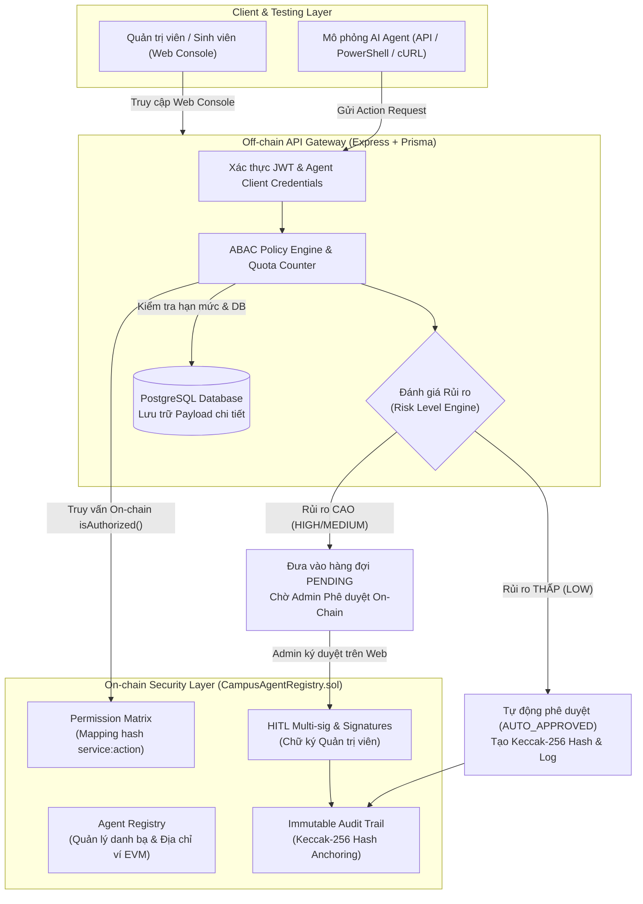
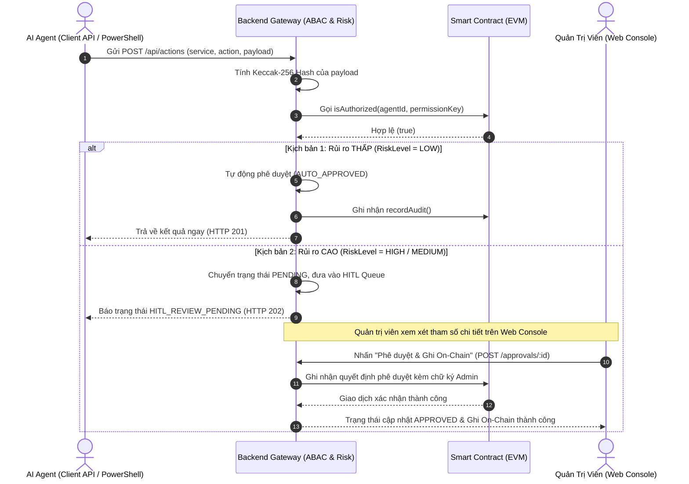

# BÁO CÁO ĐỒ ÁN CUỐI KỲ: ĐỀ TÀI 2 - AI AGENT TRUST AND AUDIT PLATFORM CHO SMART CAMPUS

- **Môn học**: Công nghệ Blockchain
- **Đề tài**: Đề tài 2 - Nền tảng Xác thực Quyền hạn và Kiểm toán Hành vi AI Agent trong Trường học Thông minh (AI Agent Trust & Audit Platform for Smart Campus)
- **Nhóm thực hiện**: Nhóm 2
  - **Trịnh Thành Đạt**
  - **Phan Lê Duy**
  - **Trần Thanh Tuấn**
- **Môi trường & Công nghệ**:
  - **Smart Contract**: Solidity 0.8.24, OpenZeppelin Contracts v5, Hardhat Node (Local EVM, Chain ID 31337)
  - **Backend API**: Node.js, Express, TypeScript, Prisma ORM, Ethers.js v6, Docker PostgreSQL 16
  - **Frontend Console**: React 19, Vite, TypeScript, Lucide Icons, Pure Vanilla CSS Design System (Dark/Light Modes, Sticky Glassmorphism)

---

## 📖 PHẦN I: BỐI CẢNH VÀ ĐẶT VẤN ĐỀ

### 1. Sự bùng nổ của Autonomous AI Agents trong Smart Campus
Trong mô hình trường học thông minh (Smart Campus), các tác tử trí tuệ nhân tạo (AI Agents) ngày càng được phân quyền tự hành để giải quyết các tác vụ hàng ngày:
* **AI Trợ lý Sinh viên (`Student Assistant`)**: Tra cứu thông tin điểm số, hỗ trợ đăng ký môn học, mượn trả sách thư viện.
* **AI Quản lý Phòng Thí Nghiệm (`Lab Controller`)**: Điều khiển tự động hóa thiết bị nghiên cứu, robot tự hành, kích hoạt hệ thống nguồn điện cao thế thí nghiệm (`HIGH_VOLTAGE_POWER`).
* **AI Quản lý Tài Chính Sinh viên (`Financial Agent`)**: Tiếp nhận yêu cầu miễn giảm học phí, xử lý giải ngân học bổng hoặc thanh toán dịch vụ ký túc xá.

### 2. Thách thức An ninh & Nhu cầu Kiến trúc Zero-Trust
Khi trao quyền cho AI Agents tương tác với cơ sở hạ tầng thực tế, hệ thống phải đối mặt với các rủi ro bảo mật nghiêm trọng:
1. **Leo thang đặc quyền (Privilege Escalation)**: Một AI Agent bị prompt injection hoặc tấn công qua API có thể tự ý gọi các hàm nhạy cảm vượt ra ngoài phạm vi phân quyền ban đầu.
2. **Nguy cơ thao túng log (Audit Log Tampering)**: Nếu toàn bộ lịch sử hành động chỉ lưu trữ trên cơ sở dữ liệu truyền thống (như MySQL/PostgreSQL), một quản trị viên biến chất hoặc kẻ tấn công chiếm được quyền root máy chủ có thể chỉnh sửa/xóa log vi phạm để xóa dấu vết.
3. **Bài toán trách nhiệm và tính không thể chối bỏ (Non-Repudiation)**: Khi một sự cố xảy ra (ví dụ: kích hoạt nhầm nguồn điện 380V gây chập cháy), cần có bằng chứng mật mã toán học bất biến để xác định chính xác: Agent nào yêu cầu, nội dung tham số (payload) nguyên bản là gì, ai đã phê duyệt, và đã thực thi lúc nào.
4. **Cân bằng giữa Tự động hóa và An toàn (Automation vs. Safety)**: Tác vụ rủi ro thấp cần được thông qua tức thì (Auto-Approved); tác vụ nguy hiểm bắt buộc phải có sự kiểm tra và ký duyệt của con người (Human-in-the-Loop - HITL) trước khi được ghi nhận on-chain.

---

## 🏛️ PHẦN II: KIẾN TRÚC TỔNG THỂ HỆ THỐNG (HYBRID ARCHITECTURE)

Hệ thống kết hợp tối ưu giữa **Off-chain Layer** (cho hiệu năng xử lý cao, quản lý hạn mức, lưu trữ payload) và **On-chain Layer** (cho tính bảo chứng bất biến, kiểm soát truy cập và đối chiếu mật mã):



### 1. Phân cấp Lưu trữ On-chain vs. Off-chain
* **Off-chain (PostgreSQL)**:
  - Lưu trữ định danh Agent, Client ID, Client Secret (băm bằng bcrypt với salt rounds = 12).
  - Lưu trữ chi tiết toàn bộ tham số JSON Payload của yêu cầu (ví dụ: thông tin phòng lab, điện áp, mã sinh viên).
  - Quản lý hạn mức hành động trong ngày (Daily Quota) theo thời gian thực.
* **On-chain (Smart Contract `CampusAgentRegistry.sol`)**:
  - Lưu trữ mã định danh `blockchainAgentId` (Keccak-256 của `agent.id`), gắn liền với địa chỉ ví Ethereum (`walletAddress`).
  - Lưu ma trận quyền: `permissionKey = keccak256(service:action)` kèm mức rủi ro (LOW, MEDIUM, HIGH) và hạn mức.
  - Lưu trữ sổ cái kiểm toán bất biến: `payloadHash`, `resultHash`, trạng thái thành công/thất bại, thời gian đóng block.

---

## 🔒 PHẦN III: THIẾT KẾ SMART CONTRACT (`CampusAgentRegistry.sol`)

Smart contract được viết bằng **Solidity 0.8.24**, kế thừa module quản trị phân quyền an toàn `AccessControl` từ thư viện OpenZeppelin v5:

### 1. Cấu trúc dữ liệu cốt lõi
```solidity
enum AgentStatus { ACTIVE, REVOKED, EXPIRED }
enum RiskLevel { LOW, MEDIUM, HIGH }

struct AgentInfo {
    address walletAddress;      // Địa chỉ ví EVM của Agent
    string name;                // Tên hiển thị (vd: Lab Robotics Controller)
    string agentType;           // Loại Agent (vd: LAB_CONTROLLER)
    AgentStatus status;         // Trạng thái vòng đời
    uint64 registeredAt;        // Thời điểm đăng ký
    uint64 expiresAt;           // Thời điểm hết hạn (0 = vĩnh viễn)
}

struct PermissionRule {
    bool allowed;               // Có được cấp quyền không
    uint32 dailyLimit;          // Hạn mức thực thi tối đa / ngày
    RiskLevel riskLevel;        // Ngưỡng rủi ro an toàn
    uint64 updatedAt;           // Thời điểm cập nhật
}

struct AuditRecord {
    bytes32 agentId;            // Mã định danh Agent
    bytes32 payloadHash;        // Hash Keccak-256 của tham số request
    bytes32 resultHash;         // Hash Keccak-256 của kết quả phản hồi
    string actionTag;           // Nhãn tác vụ (vd: LAB:HIGH_VOLTAGE_POWER)
    uint64 timestamp;           // Dấu thời gian khối (block.timestamp)
    bool success;               // Trạng thái thực thi
}
```

### 2. Các hàm chức năng chính
1. `registerAgent(bytes32 agentId, address walletAddress, string name, string agentType, uint64 expiresAt)`: Đăng ký danh bạ Agent mới lên chuỗi, liên kết ví và khởi tạo trạng thái `ACTIVE`.
2. `setPermission(bytes32 agentId, bytes32 permissionKey, bool allowed, uint32 dailyLimit, RiskLevel riskLevel)`: Phân quyền tác vụ cho Agent. `permissionKey` được băm bằng `keccak256(service:action)`.
3. `isAuthorized(bytes32 agentId, bytes32 permissionKey)`: Hàm view kiểm tra tức thì quyền hạn của Agent trực tiếp trên chuỗi mà không tốn gas.
4. `recordAudit(bytes32 requestId, bytes32 agentId, bytes32 payloadHash, bytes32 resultHash, string actionTag, bool success)`: Ghi nhận log kiểm toán mật mã không thể tẩy xóa lên Smart Contract, phát ra Event `AuditRecorded`.

---

## ⚙️ PHẦN IV: CƠ CHẾ PHÊ DUYỆT RỦI RO & HUMAN-IN-THE-LOOP (HITL)

Điểm nhấn quan trọng trong kiến trúc của Đề tài 2 là **Cơ chế Phê duyệt Kép dựa trên Đánh giá Mức độ Rủi ro (Risk-Based Policy Enforcement)**:



### 1. Tại sao thao tác Thư viện tự động duyệt (Auto Approved)?
* Quyền đọc sách thư viện (`LIBRARY / READ_BOOK`) có `riskLevel: "LOW"`. 
* Hệ thống tự động xác nhận quyền trên chuỗi, tính toán hash toàn vẹn và cấp quyền ngay lập tức để đảm bảo trải nghiệm thông suốt cho sinh viên, tránh quá tải cho quản trị viên.

### 2. Tại sao thao tác Phòng Lab cần Quản trị viên duyệt (HITL Pending)?
* Quyền cấp điện cao áp (`LAB / HIGH_VOLTAGE_POWER`) có `riskLevel: "HIGH"`.
* Dù AI Agent đã được gán quyền trong danh bạ, hệ thống Zero-Trust vẫn **chặn đứng yêu cầu**, đưa vào hàng đợi **Phê duyệt HITL**.
* Quản trị viên phải kiểm tra JSON Payload (phòng học nào, bao nhiêu vôn, mục đích thí nghiệm gì) rồi mới bấm **"Phê duyệt & Ghi On-Chain"** để ký giao dịch lên Smart Contract.

---

## 🔍 PHẦN V: QUY TRÌNH KIỂM TOÁN ĐỐI CHIẾU MẬT MÃ (CRYPTOGRAPHIC AUDIT)

Hệ thống cung cấp tab **Audit On-Chain** chuyên biệt để đối soát toàn vẹn dữ liệu:

1. **Công thức băm toàn vẹn**:
   $$\text{Payload Hash} = \text{keccak256}(\text{JSON.stringify}(payload))$$
2. **Quy trình đối chiếu**:
   * Hệ thống truy xuất mã băm lưu tại cơ sở dữ liệu Off-chain.
   * Đồng thời gọi trực tiếp lên Smart Contract `CampusAgentRegistry` qua RPC để lấy `AuditRecord` tương ứng với `requestId`.
   * **Trường hợp Khớp (MATCH - 🟢 HỢP LỆ)**: Hai mã băm `0x...` trùng khớp từng bit. Dữ liệu chứng minh còn nguyên vẹn 100%, không bị can thiệp.
   * **Trường hợp Lệch (MISMATCH - 🔴 CẢNH BÁO)**: Nếu có bất kỳ sự sửa đổi nào trong Database Off-chain (dù chỉ đổi 1 chữ số), mã băm sẽ sai lệch hoàn toàn, hệ thống lập tức gióng chuông cảnh báo vi phạm tính toàn vẹn.

---

## 🖥️ PHẦN VI: HƯỚNG DẪN VẬN HÀNH & KỊCH BẢN KIỂM THỬ

### 1. Khởi động 1-Click toàn bộ hệ sinh thái
Mở PowerShell tại thư mục gốc của dự án và chạy:
```powershell
.\scripts\start-dev.ps1
```
*Script tự động thực hiện: Khởi động Docker PostgreSQL $\to$ Bật Hardhat Node $\to$ Biên dịch & Deploy Smart Contract $\to$ Migrate database & Seed tài khoản Admin $\to$ Khởi chạy Backend (port 3100) và Frontend (port 5175).*

* **Địa chỉ giao diện**: `http://127.0.0.1:5175`
* **Tài khoản quản trị viên**:
  - Tên đăng nhập: `admin`
  - Mật khẩu: `campuspassword123`

### 2. Kịch bản kiểm thử mẫu (Test Flow)
1. **Bước 1 (Đăng ký Agent)**: Vào tab **AI Agents** $\to$ Tạo agent mới `Lab Robotics Controller` $\to$ Hệ thống cấp Client ID & Secret.
2. **Bước 2 (Gán quyền On-chain)**: Tại form Cấp quyền $\to$ Chọn Agent vừa tạo $\to$ Nhập Service: `LAB`, Action: `HIGH_VOLTAGE_POWER`, Hạn mức: `10`, Rủi ro: `HIGH` $\to$ Bấm **Lưu quyền lên Blockchain**.
3. **Bước 3 (Mô phỏng Request)**: Tại form Mô phỏng $\to$ Chọn `Lab Robotics Controller` và quyền `LAB / HIGH_VOLTAGE_POWER` $\to$ Bấm **Gửi Request Từ AI Agent** $\to$ Hệ thống báo: `ĐÃ KÍCH HOẠT HITL REVIEW (RỦI RO CAO)`.
4. **Bước 4 (Phê duyệt HITL)**: Chuyển sang tab **Phê duyệt HITL** $\to$ Xem chi tiết payload $\to$ Bấm nút xanh **Phê duyệt & Ghi On-Chain**. Nút hiển thị hiệu ứng xoay và ghi nhận giao dịch vào chuỗi.
5. **Bước 5 (Kiểm toán On-Chain)**: Chuyển sang tab **Audit On-Chain** $\to$ Bấm **Run On-Chain Audit** $\to$ Quan sát huy hiệu xanh `MATCH (KHỚP 100%)` xác thực toàn vẹn mật mã.
6. **Bước 6 (Làm sạch sau khi test)**: Bấm nút **Reset Dữ Liệu Test** ở góc trên màn hình (hoặc chạy `.\scripts\reset-db.ps1`) để đưa hệ thống về trạng thái sạch sẽ mà vẫn bảo toàn tài khoản Admin.

---

## 📦 PHẦN VII: HƯỚNG DẪN NÉN DỰ ÁN NỘP BÀI

Để file nén `.zip` nộp cho thầy đạt chuẩn, nhẹ nhàng (khoảng vài MB), không bị lỗi đường dẫn quá dài hay chứa thư mục rác:

### 1. Các thư mục BẮT BUỘC LOẠI BỎ (KHÔNG NÉN):
* ❌ `node_modules/` (ở tất cả các cấp: gốc, `backend/node_modules/`, `frontend/node_modules/`, `contracts/node_modules/`)
* ❌ `.git/` (thư mục quản lý phiên bản)
* ❌ `frontend/dist/` (thư mục build tạm)
* ❌ `contracts/cache/` và `contracts/artifacts/` (thư mục build tạm của Hardhat)

### 2. Các thư mục BẮT BUỘC PHẢI CÓ TRONG FILE NỘP:
* ✅ `contracts/`: Hợp đồng thông minh `CampusAgentRegistry.sol`, Ignition module, scripts kiểm thử.
* ✅ `backend/`: Mã nguồn Node.js/TypeScript, `prisma/schema.prisma`, cấu hình API và logic ABAC.
* ✅ `frontend/`: Toàn bộ mã nguồn React, CSS theme, assets và component giao diện.
* ✅ `scripts/`: Toàn bộ công cụ tự động hóa PowerShell (`start-dev.ps1`, `stop-dev.ps1`, `reset-db.ps1`, `health-check.ps1`).
* ✅ `docker-compose.yml`, `package.json`, `README.md`, và file báo cáo `BAO_CAO_CUOI_KY_DE_TAI_2.md`.

### 3. Lệnh PowerShell nén tự động nhanh chóng (Khuyến nghị):
Chỉ cần chạy lệnh sau tại thư mục gốc dự án:
```powershell
Get-ChildItem -Exclude "node_modules", ".git", "dist", "artifacts", "cache" | Compress-Archive -DestinationPath "..\Nhom2_DeTai2_SmartCampusAgentTrust.zip" -Force
```
File nén `Nhom2_DeTai2_SmartCampusAgentTrust.zip` sẽ được tạo ra tại thư mục cha với dung lượng tối ưu, sẵn sàng nộp cho Giảng viên.
