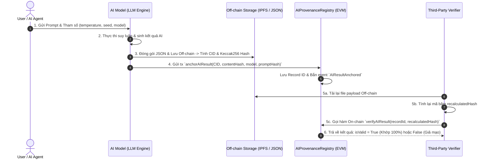

# BÁO CÁO THỰC HÀNH TUẦN 10: ORACLE, LƯU TRỮ OFF-CHAIN VÀ NGUỒN GỐC DỮ LIỆU AI

- **Môn học**: Công nghệ Blockchain
- **Bài thực hành**: Tuần 10 - Oracle, Lưu Trữ Off-chain & Xác Thực Nguồn Gốc Dữ Liệu AI (AI Provenance & Hash Anchoring)
- **Nhóm 2**: Thành viên: Trịnh Thành Đạt, Phan Lê Duy, Trần Thanh Tuấn
- **Môi trường thử nghiệm**: Local EVM Node / Solidity 0.8.24 / TypeScript / Ethers.js v6 / HTML5 / CSS Glassmorphism

---

## 📖 PHẦN I: LÝ THUYẾT NỀN TẢNG TUẦN 10

### 1. Vấn Đề Oracle (The Oracle Problem) & Phân Loại Oracle

* **Bản chất vấn đề (The Oracle Problem)**: 
  Smart Contract là môi trường thực thi tất định (deterministic) và bị cô lập hoàn toàn bên trong EVM. Smart contract **không thể tự thực hiện HTTP request ra ngoài Internet** để lấy giá vàng, thời tiết hay kết quả AI (vì nếu mỗi node miner gọi API ở thời điểm khác nhau sẽ trả về kết quả khác nhau, phá vỡ sự đồng thuận). **Oracle** là cầu nối đưa dữ liệu từ thế giới thực (Off-chain) vào Smart Contract (On-chain).

* **Phân loại Oracle**:
  - **Push Oracle**: Nguồn dữ liệu chủ động đẩy (push) dữ liệu định kỳ vào Smart Contract (VD: Chainlink Price Feeds cập nhật giá ETH/USD mỗi khi giá biến động > 0.5%).
  - **Pull Oracle (On-demand)**: Dữ liệu chỉ được lấy và xác thực khi có người dùng/giao dịch yêu cầu (VD: Pyth Network, Chainlink Data Streams giúp tiết kiệm gas khi không có giao dịch).
  - **Oracle tập trung vs Phi tập trung**: Oracle tập trung (1 máy chủ đẩy giá) có nguy cơ điểm lỗi đơn (Single Point of Failure). Mạng Oracle phi tập trung (Decentralized Oracle Network - DON như Chainlink) tổng hợp dữ liệu từ hàng chục Node độc lập và lấy trung vị (Median) để chống thao túng.

---

### 2. So Sánh Lưu Trữ Dữ Liệu On-chain vs. Off-chain

| Tiêu chí | Lưu trữ On-chain (Blockchain State Trie) | Lưu trữ Off-chain (IPFS / Arweave / Cloud) |
| :--- | :--- | :--- |
| **Chi phí** | 🔴 **Cực kỳ đắt đỏ** (~vài chục USD / MB trên Mainnet) | 🟢 **Rất rẻ / Miễn phí** |
| **Dung lượng** | Giới hạn (Block gas limit ~30 triệu gas) | Không giới hạn (Gigabytes / Terabytes) |
| **Khả năng tính toán** | Chỉ phù hợp với logic đơn giản, số dư, quyền hạn | Chạy được mô hình AI lớn, xử lý hình ảnh, video |
| **Tính riêng tư** | Công khai 100% (Ai cũng đọc được qua RPC) | Có thể mã hóa hoặc phân quyền truy cập |
| **Tính bất biến** | Bất biến 100% theo sự đồng thuận của mạng | Bất biến thông qua **Content Addressing (IPFS CID)** |

> [!IMPORTANT]
> **Vì sao KHÔNG đưa Mô hình Lớn (LLM) và Dữ liệu Nhạy cảm trực tiếp lên chuỗi?**
> 1. **Dung lượng & Chi phí Gas**: Mô hình LLM (như Llama, GPT) nặng từ hàng chục đến hàng trăm Gigabytes, vượt xa giới hạn block của Blockchain.
> 2. **Tính toán Bất khả thi**: EVM không được thiết kế cho tính toán ma trận dấu phẩy động của AI.
> 3. **Bảo vệ Bí mật & Quyền riêng tư**: Blockchain là sổ cái công khai. Nếu đưa trọng số mô hình độc quyền hoặc dữ liệu y tế/tài chính nhạy cảm lên chuỗi, bất kỳ ai cũng có thể đọc và trích xuất.

---

### 3. Content Addressing, IPFS, CID và Merkle DAG

* **Location Addressing (Web2 truyền thống)**: Tìm dữ liệu theo *Vị trí máy chủ* (`https://server.com/file.json`). Nếu máy chủ đổi file hoặc sập, liên kết bị hỏng hoặc bị sửa đổi mà không ai hay biết.
* **Content Addressing (Web3 / IPFS)**: Tìm dữ liệu theo **Nội dung mã băm (Cryptographic Hash)** của chính file đó (`ipfs://bafybeic...`).
  - **CID (Content Identifier)**: Mã định danh tự thân đại diện cho nội dung dữ liệu. Nếu bạn sửa dù chỉ **1 dấu chấm** trong file, mã CID sẽ thay đổi hoàn toàn!
  - **Merkle DAG (Directed Acyclic Graph)**: Cấu trúc cây dữ liệu đồ thị có hướng không chu trình của IPFS, giúp chia file lớn thành các khối (blocks), liên kết với nhau bằng mã băm giúp tải dữ liệu phân tán và chống can thiệp.

---

### 4. Kỹ Thuật Neo Dữ Liệu Lên Chuỗi (Hash Anchoring)

**Hash Anchoring** là kỹ thuật kết hợp ưu điểm của cả hai thế giới:
1. **Lưu dữ liệu nặng Off-chain**: Toàn bộ Prompt, Tham số suy luận, Kết quả AI chi tiết (JSON/PDF/Hình ảnh) được lưu trên IPFS hoặc cơ sở dữ liệu phân tán.
2. **Neo mã băm On-chain**: Chỉ gửi một mã băm nhỏ gọn (32-bytes `keccak256` hoặc IPFS CID) cùng Timestamp và Chữ ký của AI Agent lên Smart Contract trên Blockchain.
3. **Bảo chứng**: Blockchain đóng vai trò làm **Tòa án Trọng tài Bất biến** xác nhận: *"Bản ghi AI này đã tồn tại chính xác tại thời điểm $T$, do Agent $A$ sinh ra, và nội dung không hề bị chỉnh sửa!"*.

---

## 🔬 PHẦN II: GIẢI PHẪU 6 BƯỚC PIPELINE XÁC THỰC NGUỒN GỐC AI

Quy trình thực thi trong kịch bản `scripts/ai_pipeline.ts` và Web Dashboard:



---

## 📊 PHẦN III: KẾT QUẢ THỰC NGHIỆM PIPELINE VÀ DEMO

### 1. Kết quả chạy Pipeline (`npm run pipeline`):

```
========================================================================
  [TUẦN 10] PIPELINE XÁC THỰC NGUỒN GỐC DỮ LIỆU AI & HASH ANCHORING     
========================================================================

✅ Smart Contract AIProvenanceRegistry đã triển khai tại: 0x5FbDB2315678afecb367f032d93F642f64180aa3

🔹 [BƯỚC 1: AI NHẬN DỮ LIỆU ĐẦU VÀO (PROMPT & PARAMETERS)]
   + Prompt: "Phân tích rủi ro an ninh mạng trong hợp đồng thông minh DeFi..."
   + Model Version: gemini-1.5-pro-preview-0820
   + Prompt Keccak256 Hash: 0x8a92f8...

🔹 [BƯỚC 2: AI SINH KẾT QUẢ (INFERENCE EXECUTION)]
   + Kết quả AI đã được sinh thành công (JSON structured output)!

🔹 [BƯỚC 3: ĐÓNG GÓI & LƯU TRỮ OFF-CHAIN (CONTENT ADDRESSING / IPFS)]
   + File đã lưu tại: offchain_storage/bafybeic...json
   + IPFS Content Identifier (CID): bafybeic827e4...
   + Content Keccak256 Hash:        0x4f12a9...

🔹 [BƯỚC 4: NEO MÃ BĂM LÊN BLOCKCHAIN (HASH ANCHORING ON-CHAIN)]
   ✅ Giao dịch đã đóng vào Block #2! Gas Used: 118,520
   📌 Record ID được cấp trên Blockchain: 0x9c31fa...

🔹 [BƯỚC 5: TẢI LẠI DỮ LIỆU OFF-CHAIN & KIỂM CHỨNG TÍNH TOÀN VẸN]
   --- Kiểm chứng 1: Dữ liệu nguyên bản từ Off-chain storage ---
   -> Kết quả đối chiếu với On-chain State: 🟢 HỢP LỆ (AUTHENTIC & UNTAMPERED)
   
   --- Kiểm chứng 2: Giả lập kẻ gian sửa đổi điểm auditScore từ 88 -> 99 ---
   -> Kết quả đối chiếu với On-chain State: 🔴 CẢNH BÁO: DỮ LIỆU ĐÃ BỊ CHỈNH SỬA / KHÔNG KHỚP!

🔹 [BƯỚC 6: EVENT EMISSION & KẾT LUẬN]
   Event phát ra: AIResultAnchored (Record: 0x9c31fa..., CID: bafybeic...)
```

---

## 🚀 PHẦN IV: HƯỚNG DẪN CHẠY DEMO WEB DASHBOARD

1. Khởi chạy Local EVM Node:
   ```bash
   npx hardhat node
   ```
2. Deploy Smart Contract & sinh cấu hình Frontend:
   ```bash
   npm run deploy
   ```
3. Chạy kiểm thử tự động toàn bộ 6 bước Pipeline:
   ```bash
   npm run pipeline
   ```
4. Mở Web Server trải nghiệm Prototype tương tác:
   ```bash
   npm run dev
   ```
   Truy cập: **`http://localhost:3000`**
